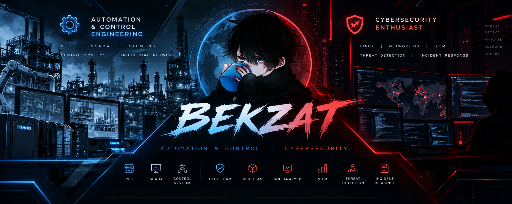

  

<h1>👋 Hey, I'm Bekzat</h1>

  <strong>⚙️ Automation & Control Engineering</strong>
  &nbsp;&nbsp;•&nbsp;&nbsp;
  <strong>🔐 Cybersecurity</strong>

 

 

## 🧑‍💻 About Me

I'm a <strong>4th-year Automation & Control Engineering student</strong> at
<strong>Kazakh-British Technical University (KBTU)</strong> with an equal
interest in <strong>industrial technologies and cybersecurity</strong>.

I enjoy understanding how systems are
<strong>controlled, connected, monitored, and secured</strong>.

📚 Currently preparing for the <strong>Cisco CCNA</strong> exam and
practising on <strong>Hack The Box</strong>.

 

<table align="center">
<tr>

<td width="50%" valign="top">

### ⚙️ Automation & Control

🏭 Industrial Automation  
🎛️ Control Systems  
🔧 PLC  
🖥️ SCADA  
📟 HMI  
⚡ Industrial Technologies  
🌐 Industrial Networks  

</td>

<td width="50%" valign="top">

### 🔐 Cybersecurity

🧱 Network Security  
🔵 Blue Team  
🔴 Red Team  
🛡️ SOC Analysis  
📊 SIEM & Log Analysis  
🔎 Threat Detection  
🚨 Incident Response  

</td>

</tr>
</table>

 

## 🛠️ Technologies & Tools

### ⚙️ Automation

  

### 🔐 Security

  

